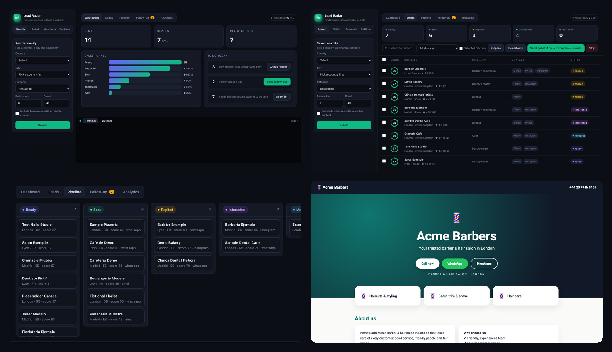
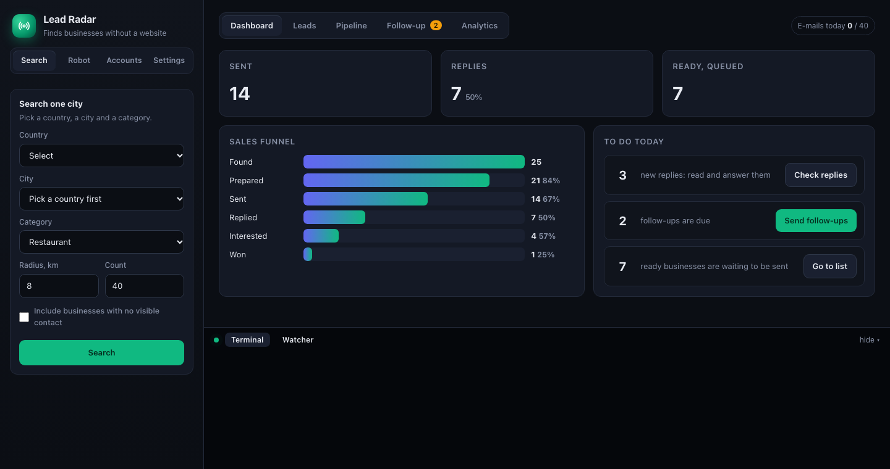
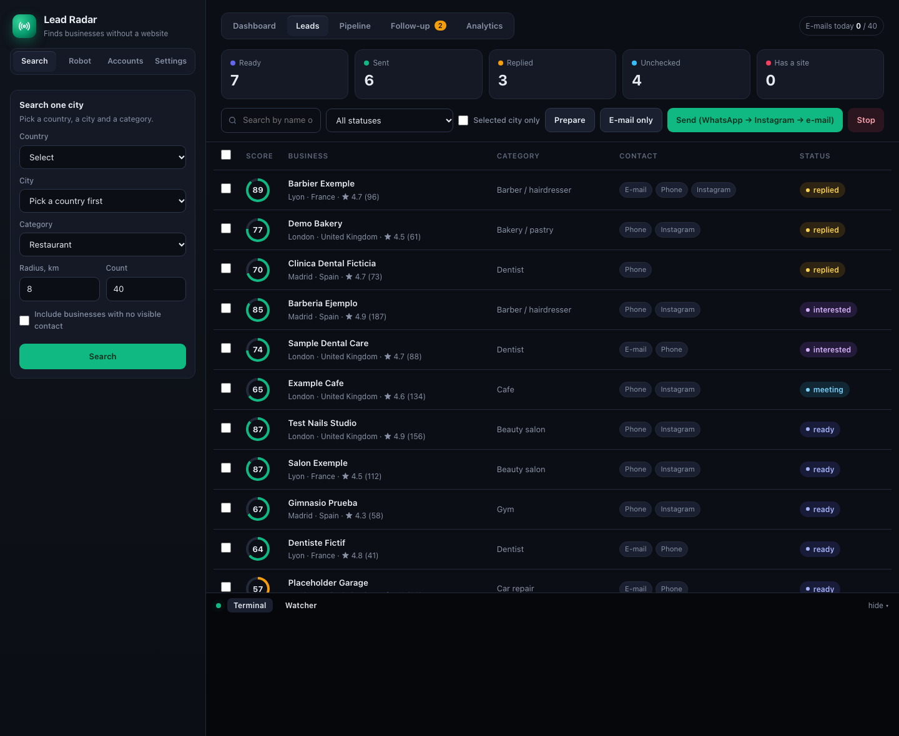
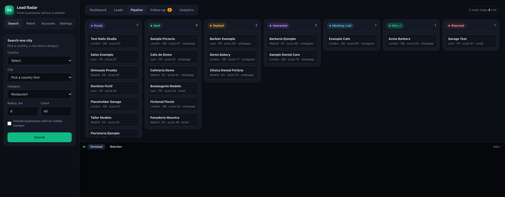
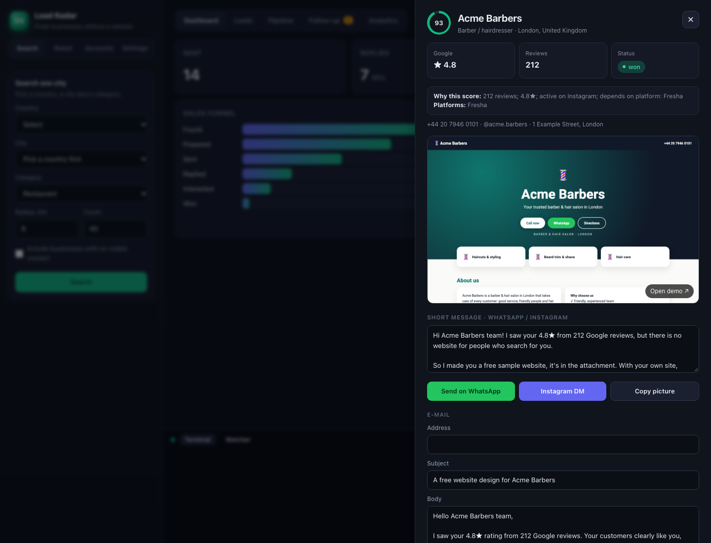
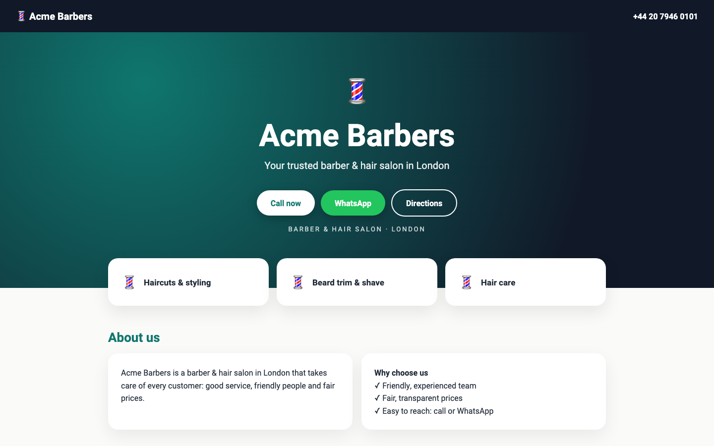
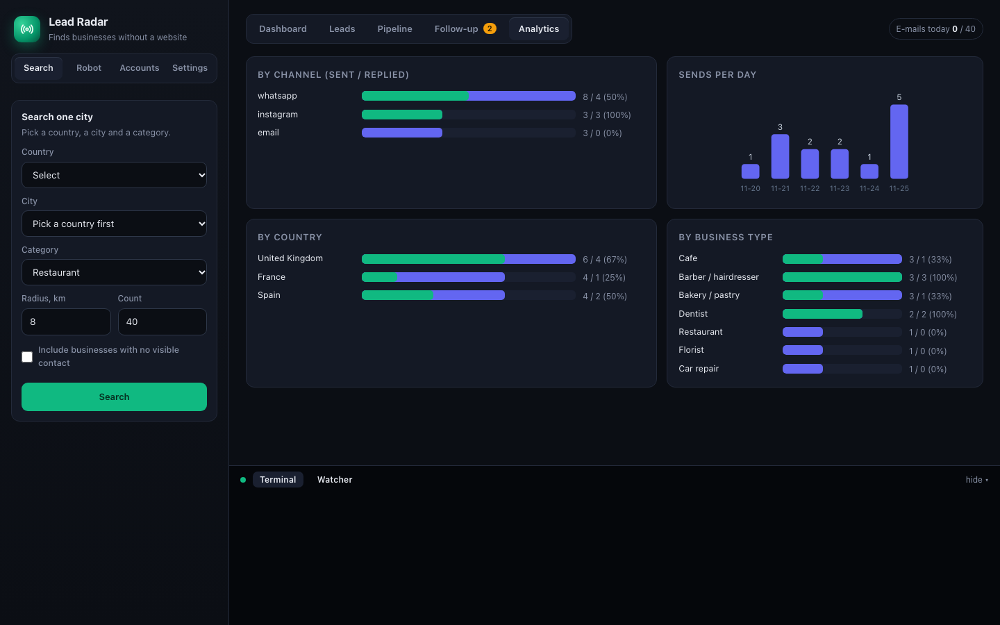
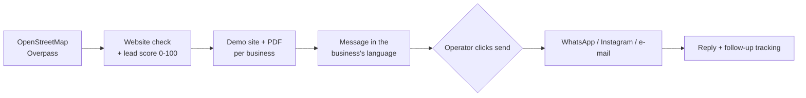

# Lead Radar

**Find small businesses without a website, build each one a free sample site, draft a first message in their own language, and send only when you click.**

[](https://github.com/Zeusmma/lead-radar/actions/workflows/test.yml)
[](LICENSE)




Portfolio sample: it shows the end-to-end pipeline, not a hosted product. All data in the images is fictional.

## Contents

- [At a glance](#at-a-glance)
- [Quick start](#quick-start)
- [Set up with an AI assistant](#set-up-with-an-ai-assistant)
- [Screenshots](#screenshots)
- [Features](#features)
- [Architecture](#architecture)
- [Configuration](#configuration)
- [Safety notes](#safety-notes)
- [Project structure](#project-structure)
- [FAQ](#faq)
- [Limitations](#limitations)
- [Contributing](#contributing)
- [License](#license)

## At a glance

| | |
|---|---|
| Lines of code | JSON 1,877 · Python 1,500 · HTML 388 · Shell 64 · YAML 17 (total 3,846) |
| Checks | Self-test with 42 assertions (`python3 radar.py --selftest`) plus `py_compile`, run in CI |
| Platforms | macOS (full), Linux (self-test, UI, browser tasks with Chrome), Windows via WSL (self-test and UI) |
| Dependencies | 0 for the app and self-test (Python 3.9+ standard library); 1 optional (Playwright) for browser tasks |
| Languages | 10 message languages (en, de, fr, es, it, nl, pl, pt, ru, tr), template packs in `i18n/` |
| Storage | Local SQLite file, no external service required |

## Quick start

```sh
git clone https://github.com/Zeusmma/lead-radar.git && cd lead-radar
./scripts/setup.sh          # venv + requirements + .env + self-test (add --with-browser for Chrome)
./scripts/run.sh            # open http://127.0.0.1:8790
```

Without the setup script (Python 3.9+, standard library only):

```sh
python3 radar.py --selftest
python3 radar.py
```

Google Chrome and Playwright are needed only for browser tasks (website check, sending, PDF brochures); the self-test and the web UI need neither. In the UI: Settings tab (sender name, contact, price, postal address), Accounts tab (log in once to Gmail, Instagram, WhatsApp Web inside the dedicated Chrome window), then Search or the auto radar.

## Set up with an AI assistant

[`AI_SETUP.md`](AI_SETUP.md) has a copy-paste prompt and a numbered checklist for Claude Code, Cursor or any AI coding assistant: prerequisites, installation, optional settings, verification with expected output, troubleshooting and uninstall. The assistant is told to ask before installing a browser and never to invent credentials.

## Screenshots

All data below is fictional (generated by `scripts/seed_demo_data.py`).

| Dashboard | Leads |
|---|---|
|  |  |



| Lead detail | Generated demo site |
|---|---|
|  |  |



## Features

- **Discovery**: queries OpenStreetMap (Overpass API) for businesses in a chosen country, city and category that have no website tag.
- **Website check and lead scoring**: for each business it checks Google's business panel and result domains to confirm there is no own website, then scores the lead 0-100 from public business data (review count, rating, presence on booking/delivery platforms, Instagram, category value, country, reachability).
- **Message in the business's own language**: first message and follow-ups use per-language templates (`i18n/`), including regional language choice (for example French in Montreal, Dutch in Ghent), plus facts about the business (rating, reviews, platform dependence) in the text.
- **Demo page generation**: a static sample site per business (services, about, phone/WhatsApp buttons, OpenStreetMap map, opening hours), a screenshot, and a short PDF brochure.
- **Channels and limits**: WhatsApp Web, Instagram DM and e-mail, driven through one dedicated Chrome profile (Playwright). Daily caps per channel, human-like pauses, and local business hours only (9:00-19:00 in the business's time zone).
- **Compliance guards**: e-mail is blocked for countries where cold B2B e-mail needs prior consent, and for personal free-mail addresses in the UK; an opt-out line is part of every template; a postal address is appended for US/Canada.
- **Reply and follow-up tracking**: matches WhatsApp chats, Instagram threads and the Gmail inbox against already-contacted leads only, stops follow-ups on any reply, and sends at most two reminders (day 3 and day 7).
- **Human click to send**: nothing is sent automatically. The auto-radar only discovers and prepares; sending starts from an explicit click and a confirm dialog.
- **Pipeline UI**: dashboard, lead list, kanban pipeline, follow-up queue, analytics, and a watcher that raises alerts on blocks, stuck jobs and failure streaks.

## Architecture



`radar.py` is a single-file stdlib HTTP server with SQLite storage. `browser.py` runs all browser work on one Playwright thread against a dedicated Chrome profile, so a hung page cannot block the server.

## Configuration

Environment variables (copy `.env.example` to `.env`; `scripts/run.sh` loads it):

| Variable | Purpose |
|---|---|
| `SMTP_USER`, `SMTP_PASSWORD`, `SMTP_HOST`, `SMTP_PORT` | Optional SMTP sending; without a password, Gmail web in the dedicated Chrome is used |
| `CHROME_BIN` | Chrome binary for headless screenshots (default is the macOS path) |
| `LEAD_RADAR_DATA`, `LEAD_RADAR_PORT` | Data directory (default `./data`) and HTTP port (default 8790) |
| `LLM_API_KEY` | Only for `i18n/translate.py` (generating new language packs) |

## Safety notes

- Portfolio sample. Review the law of every target country before contacting anyone; the built-in guards are a starting point, not legal advice.
- No credentials are stored in the repo or the database. Browser logins live only in the local Chrome profile under `data/`.
- Reply detection reads only chat titles and previews, and keeps only rows that match leads already contacted.
- Automating WhatsApp, Instagram or Gmail may violate those services' terms; use low volumes and your own accounts at your own risk.
- All business names in the self-test are fictional. Lead data is collected from public OpenStreetMap and search results and is never committed (`data/` is ignored).

## Project structure

| File | Role |
|---|---|
| `radar.py` | HTTP server (stdlib), SQLite storage, discovery, scoring, demo and message generation, send/follow-up jobs, watcher |
| `browser.py` | Single-thread Playwright driver for the dedicated Chrome profile (Google check, WhatsApp Web, Instagram, Gmail web) |
| `pdfmaker.py` | Turns a demo page into a short PDF brochure and picture set |
| `ui.html` | Single-page web UI served at `http://127.0.0.1:8790` |
| `scripts/setup.sh` | One-command setup: venv, requirements, `.env`, self-test (`--with-browser` installs Chrome for Playwright) |
| `scripts/run.sh` | Loads `.env` and starts the app |
| `requirements.txt` | Playwright (browser tasks only) |
| `AI_SETUP.md` | Prompt and checklist for AI-assisted setup |
| `scripts/seed_demo_data.py` | Fills a temp data dir with fictional leads (for screenshots and demos) |
| `i18n/` | Message and site templates per language (`dm/` holds the short direct-message pack) |

Data lives in `data/` (SQLite DB, demo pages, Chrome profile), which is git-ignored.

## FAQ

**Does it send messages on its own?** No. The auto-radar only discovers and prepares. Sending starts from an explicit click and a confirm dialog.

**Do I need an API key?** No. Discovery uses the public Overpass API. Keys are only for optional SMTP and for generating new language packs.

**Where is my data?** In `data/` next to the code (SQLite database, demo pages, Chrome profile). It is git-ignored; delete the folder to wipe everything.

**Why Google Chrome and not Chromium?** The browser driver launches Playwright with `channel="chrome"` so logins to Gmail, Instagram and WhatsApp Web behave like a normal browser profile.

**Can I add a country or category?** Yes, edit the `COUNTRIES` and `CATEGORIES` tables at the top of `radar.py`.

## Limitations

- Discovery relies on OpenStreetMap coverage; small towns may return few results.
- Driving WhatsApp, Instagram and Gmail through a browser is fragile and can break when those sites change.
- Browser automation is developed on macOS; on Linux set `CHROME_BIN`, on Windows use only the self-test and the UI.
- Planned: a pluggable message-template editor in the UI and CSV export.

## Contributing

Issues and pull requests are welcome, see [CONTRIBUTING.md](CONTRIBUTING.md). Report security problems as described in [SECURITY.md](SECURITY.md). Release notes are in [CHANGELOG.md](CHANGELOG.md).

## License

MIT, see [LICENSE](LICENSE).
